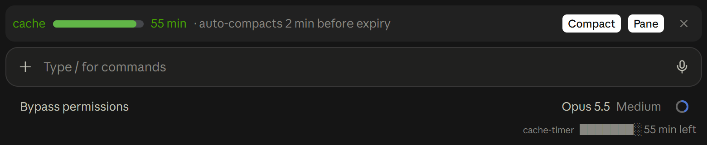
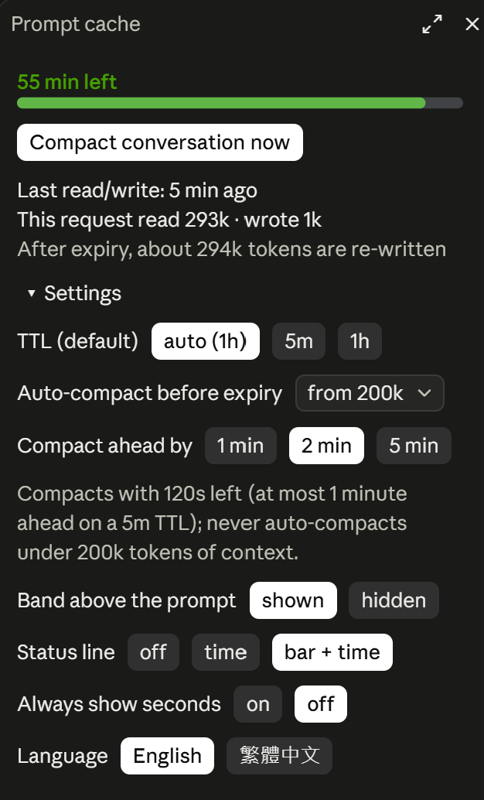

# claude-cache-timer

[English](README.md) | **繁體中文**

[](https://github.com/mileschintw/claude-cache-timer/releases)
[](LICENSE)

**Claude Code 的 prompt 快取倒數與自動壓縮：一眼看出快取還剩多久，趁過期前先壓縮對話，不必花錢把一長段上下文重新寫進快取。**



支援 Claude Code 終端機，以及 Claude 桌面版的 Code 分頁。介面有英文與繁體中文。

## 亮點

### 簡潔好讀的進度條

- **狀態列隨時可見**：在 `cache-timer` 標籤旁顯示例如 `████░░░░ 剩 27 分鐘`，預設開啟，不需要任何設定。空間不夠時可以只留 `剩 27 分鐘`。
- **提示框上方的一列**：預設開啟，按一下就能隱藏。進度條隨快取消耗從綠轉黃再轉紅，旁邊是剩餘時間、自動壓縮何時執行（只在開啟時顯示），以及「立即壓縮」按鈕。視窗變窄時會先拿掉較不重要的部分，絕不換行。
- **桌面版原生質感**：桌面版用 SVG 畫成圓角長條，終端機則使用方塊字元：

  ```
  快取 █████░░░░░ 28 分鐘 · 到期前 2 分鐘自動壓縮 [ 立即壓縮 ] [ 面板 ] ✕
  ```

### 內建自動壓縮

Claude Code 的 prompt 快取閒置 5 分鐘或 1 小時就會過期。過期後的下一則訊息必須把整段上下文重新寫進快取，而快取寫入比一般輸入更貴。在長對話裡，這往往是你送出最貴的一則訊息。

開啟自動壓縮後，mod 會在快取過期前 1、2 或 5 分鐘，**趁快取還有效時**壓縮對話。下一則訊息就只需要重新快取一段摘要，而不是整份對話紀錄，省下大量 tokens。

```
/cache auto 100k
```

自動壓縮預設關閉，因為壓縮會失去細節。它只在 Claude 閒置時觸發，每個快取週期最多一次，而且上下文要達到你選的門檻：50k、100k、200k 或 500k tokens（`/cache auto on` 用 100k）。想自己決定時機？按一下「立即壓縮」按鈕效果相同。

## 安裝

在 Claude Code 的終端機 session 中輸入：

```
/plugin install cache-timer --marketplace mileschintw/claude-cache-timer
```

詢問是否新增 marketplace 時回答 `y`，再選擇 user scope。以 user scope 安裝後，Claude 桌面版的 Code 分頁也會載入這個 mod。不過桌面版不能執行 `/plugin` 指令，請在終端機裡安裝。

marketplace 安裝的是最新的 [release](https://github.com/mileschintw/claude-cache-timer/releases)，不是 `main` 的最新 commit。

<details>
<summary>改用 clone 下來的資料夾</summary>

```bash
git clone https://github.com/mileschintw/claude-cache-timer.git ~/.claude/mods/cache-timer
```

接著在 `~/.claude/settings.json` 的 `env` 區塊加入這個資料夾：

```json
{
  "env": {
    "CLAUDE_CODE_PLUGIN_DIRS": "~/.claude/mods/cache-timer"
  }
}
```

之後開啟的每個 session 都會載入它。
</details>

**需求**：支援 function-hook mod 的 Claude Code 版本（目前仍是搶先體驗 API）。已在 Claude Code 2.1.300 的終端機與桌面版上測試。

## 完整功能

- **狀態列倒數**：剩 5 分鐘前只顯示分鐘，最後 5 分鐘顯示 `mm:ss`，過期後顯示 `已過期`。預設顯示進度條和時間，也可以只顯示時間或關閉。
- **提示框上方的進度條**：預設開啟，可以按它的 ✕（桌面版是「隱藏」）或用 `/cache band off` 隱藏。快取過期後會顯示下一則訊息要重新寫入多少 tokens。上面的「面板」按鈕會開啟 `/cache` 面板，面板開著時按鈕會亮起；再按一次就會關閉面板。
- **`/cache` 面板**：剩餘時間和「立即壓縮」按鈕、上次讀寫了多少 tokens，以及過期後要重新寫入多少 tokens。下方的設定收在「▸ 設定」底下，展開後每一項是一排按鈕，目前的值會標示出來（自動壓縮是下拉選單）；面板會記住展開或收合。

  
- **到期提醒**：1h 快取在過期前 5 分鐘提醒（5m 快取是前 1 分鐘），過期時再提醒一次。
- **自動壓縮**：預設關閉。從下拉選單選「關」或上下文門檻；在過期前 1、2 或 5 分鐘、快取還有效時壓縮對話。
- **一鍵壓縮**：在進度條或面板按按鈕。壓縮進行中按鈕會顯示「壓縮中…」，完成後進度條會提示下一則訊息會寫入新的快取。
- **TTL 自動偵測**：一開始假設是 1h，再依 API 回報的實際情況自動修正。隔了 5 分鐘以上還能讀到快取，代表是 1h；隔 5 到 55 分鐘後必須整段重寫，代表是 5m。切換模型時，Claude Code 也會直接回報 TTL。自動偵測就是「自動」這個選項；選 5m 或 1h 則會固定 TTL。
- **重開不中斷**：重開 app 或恢復 session 後，倒數會馬上接續。
- **英文或繁體中文介面**：見[介面語言](#介面語言)。

## 使用方式

送出第一則訊息後，狀態列就會出現倒數。其餘操作都透過 `/cache`：

| 指令 | 作用 |
| --- | --- |
| `/cache` | 開啟面板；無法顯示面板時，直接列出相同的數據 |
| `/cache auto 50k\|100k\|200k\|500k\|off` | 從該上下文大小起開啟自動壓縮，或關閉（`on` 沿用目前的門檻） |
| `/cache ahead 1m\|2m\|5m` | 自動壓縮在到期前多久執行 |
| `/cache ttl auto\|5m\|1h` | 自動偵測 TTL，或固定為 5m 或 1h |
| `/cache status bar` / `time` / `off` | 狀態列顯示進度條和剩餘時間（預設）、只顯示時間，或不顯示 |
| `/cache band on` / `off` | 顯示或隱藏提示框上方的進度條（預設開） |
| `/cache seconds on` / `off` | 一律顯示 `mm:ss`，不在剩 5 分鐘前只顯示分鐘（預設關） |
| `/cache lang en` / `zh-TW` | 切換介面語言 |

設定會跨 session 保存。

### 介面語言

進度條、面板、提醒和 `/cache` 的回覆可以用英文（`en`，預設）或繁體中文（`zh-TW`）顯示。切換方式有三種：

- **Plugin 設定**：plugin 的 `lang` 選項，在 `/config` 裡是一個下拉選單。安裝時也可以直接選。
- **面板**：`/cache` 面板的「語言」那一列，每種語言各有一個按鈕。
- **指令**：`/cache lang en` 或 `/cache lang zh-TW`。

以最後一次變更為準。在面板或用 `/cache lang` 選的語言會和其他設定一起保存，直到 plugin 設定本身改變為止；改了 plugin 設定，介面就會換成新的值。

## 運作原理

- **計時方式**：主對話的每一次模型請求都會回報從快取讀了多少 tokens、寫入多少。只要有讀或寫，倒數就從那一刻重新開始。子代理（subagent）的請求有各自的快取，不列入計算。
- **重開之後**：計時器會隨時存下來（保留最近 20 個 session）。在 0.3 之前最後使用的 session，或 fork 出來的 session，沒有存檔，倒數會依對話紀錄最後一次回覆的時間估算，面板只顯示上下文大小。
- **自動壓縮的條件**：只在 Claude 閒置時觸發，每個快取週期最多一次，而且上下文要達到你選的門檻（用 `/cache auto on` 開啟時為 100k）。上下文比門檻短時，壓縮省下的成本不值得犧牲細節。5m 快取不論「提前壓縮」設多少，最多只提前 1 分鐘，所以停頓不到 4 分鐘時絕不會壓縮。
- **桌面版的壓縮**：桌面版（以及 SDK 或 `-p` 的 session）不允許 mod 直接壓縮，所以在那裡按壓縮按鈕會執行 `/compact`，結果會顯示在對話紀錄裡。
- **重新計時**：任何壓縮（`/compact`、Claude Code 內建的自動壓縮，或這個 mod 觸發的）都會取代原本的快取內容，計時器會等到下一則訊息再開始。

## 隱私與權限

- **資料不會離開你的電腦**：這個 mod 不發出任何網路請求。每次模型回應，它只讀取 token 數（快取讀取、快取寫入、未快取的輸入），不讀內容。程式裡的 `http://www.w3.org/2000/svg` 是進度條 SVG 的命名空間，不是它會連線的位址；它也不讀取任何憑證或環境變數。
- **通知**：它的輸出都在畫面上：狀態列、進度條、面板，以及到期提醒。提醒以 app 內的 toast 顯示，在終端機還會發出系統通知，內容只有提醒文字和 token 數。
- **會執行的指令**：在桌面版，以及 SDK 或 `-p` 的 session 中，「立即壓縮」按鈕和自動壓縮會執行 `/compact`，也只會執行這個指令：在你按下按鈕時，或開啟自動壓縮後、Claude 閒置且快取即將過期時。在終端機則改用 Claude Code 本身的壓縮功能。
- **Hooks**：它監聽 `turn.start`、`turn.step`、`turn.complete`、`session.start`、`session.compact`、`ui.close`（得知面板已關閉）、恢復 session 與切換模型的事件、它自己的 `/cache` 指令，以及 `AbovePrompt` 區塊和它自己的面板。每個事件都原封不動地往下傳，它只讀取 token 數、回報的快取 TTL，以及是否發生壓縮。
- **儲存的資料**：設定，以及最近 20 個 session 的計時，存在 Claude Code 本機的 plugin 儲存空間。

`.github/` 資料夾是這個 repo 用來發版的 CI，不屬於執行中的 plugin。

## 限制

- **桌面版沒有系統通知**：在桌面版裡，提醒只會以 app 內的 toast 顯示；如果你不在視窗前，就不會看到。
- **倒數是估計值**：時間從回應結束時算起，和 API 那邊的時鐘可能差幾秒。
- **對話框取代提示框時，進度條會被隱藏**：當對話框佔據提示框的位置時，Claude Code 不會畫出進度條，包括問題（終端機）、計畫核准，以及桌面版的「下一步」卡片。回答之後進度條就會回來。在桌面版，「下一步」卡片底下的狀態列仍然看得到，所以倒數還在；在終端機，狀態列也會一起被隱藏。
- **壓縮會失去細節**：所以自動壓縮預設是關閉的。

## 開發

```bash
claude plugin validate .
claude plugin test .
```

主要程式在 [`hooks/register.tsx`](hooks/register.tsx)，狀態型別定義在 [`types/index.d.ts`](types/index.d.ts)，測試在 [`tests/`](tests/)。

## 授權

[MIT](LICENSE)
